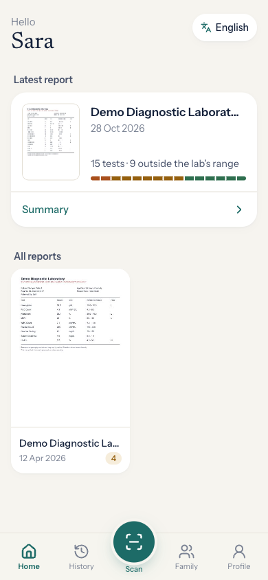
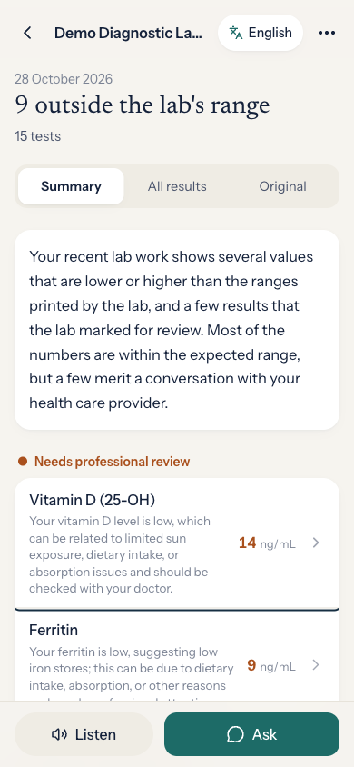
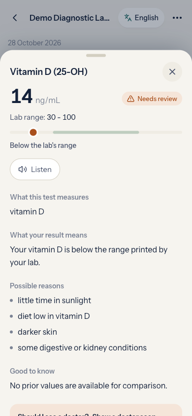
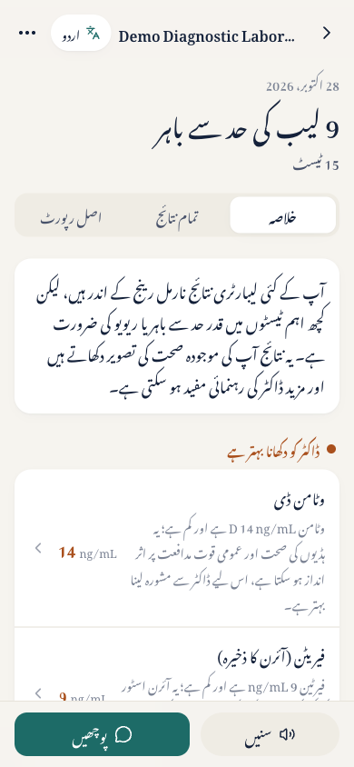
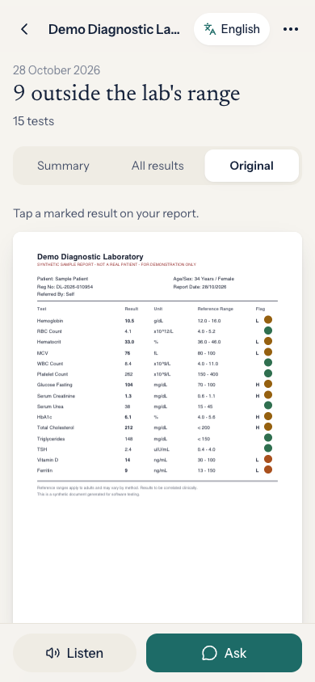
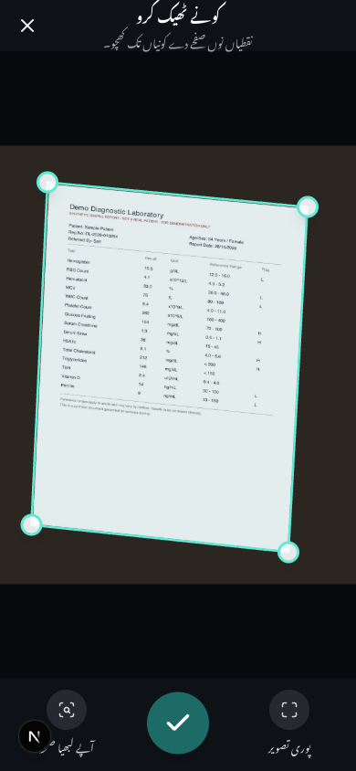
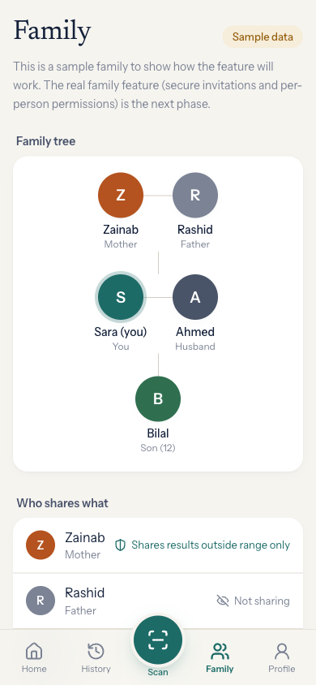
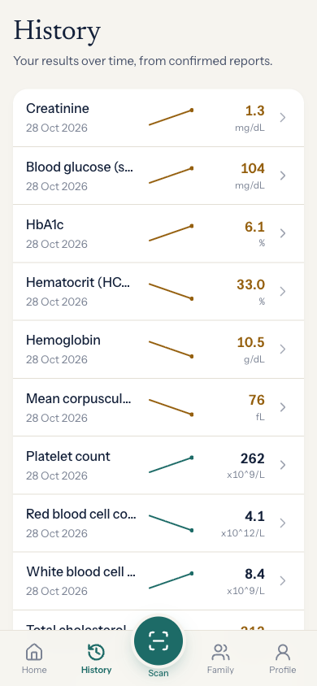
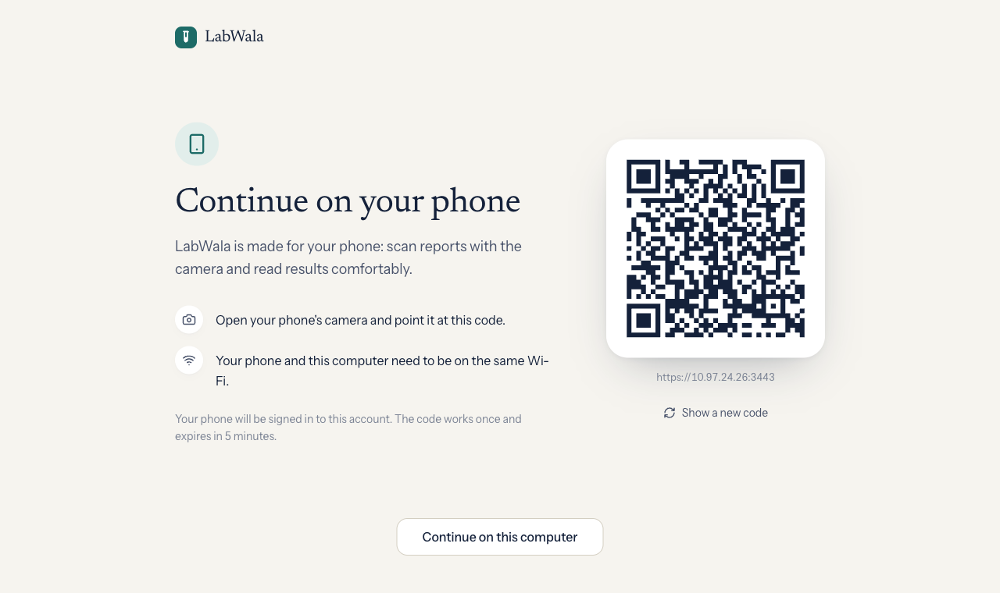
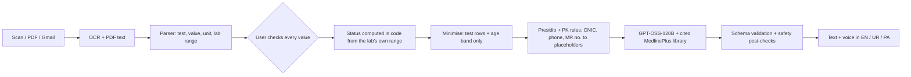

<div align="center">

# 🧪 LabWala · لیب والا

**Understand your lab report in your own language — English, Urdu and Punjabi, in text and voice.**

Scan a report with your phone. LabWala reads it, lets you check every value, and explains each result in simple words,
using the reference ranges printed by *your* lab. It explains; it never diagnoses.

   -f55036)    

</div>

<table>
<tr>
<td align="center"><br/><sub><b>Report library</b></sub></td>
<td align="center"><br/><sub><b>Summary, grouped by importance</b></sub></td>
<td align="center"><br/><sub><b>Tap a result → explanation + voice</b></sub></td>
<td align="center"><br/><sub><b>اردو · Punjabi · English</b></sub></td>
</tr>
<tr>
<td align="center"><br/><sub><b>Explain directly on the original report</b></sub></td>
<td align="center"><br/><sub><b>Scanner with edge detection</b></sub></td>
<td align="center"><br/><sub><b>Family view (sample data)</b></sub></td>
<td align="center"><br/><sub><b>Results over time</b></sub></td>
</tr>
</table>

<p align="center"><br/><sub><b>On a laptop, LabWala offers a QR code to continue on your phone (one-time sign-in link)</b></sub></p>

---

## ▶ Run it — one command

Needs only **[Docker Desktop](https://www.docker.com/products/docker-desktop/)**.

```bash
git clone https://github.com/DyneStein/City-Lab-AI-Hackathon.git
cd City-Lab-AI-Hackathon
docker compose up --build
```

Open **http://localhost:3100** → **Continue on this computer** → **Create account** → tap **Scan** → **Sample report**.
The first build takes a few minutes. Stop with `Ctrl+C`.

**Works without any keys** — explanations then come from the built-in, cited medical library (in all three languages).

<details>
<summary><b>Optional: switch on AI explanations and Gmail import (free keys)</b></summary>

1. `cp labwala/.env.example labwala/.env`
2. In `labwala/.env` set:
   - `AI_API_KEY=` → free Groq key from <https://console.groq.com/keys>
   - `GOOGLE_CLIENT_ID=` / `GOOGLE_CLIENT_SECRET=` → Gmail (step-by-step inside the file; add your Gmail as a *test user*)
3. `docker compose up --build`

For phones on the same Wi-Fi, add `PUBLIC_URL=http://<laptop-ip>:3100` so the laptop's QR code points to the laptop.
</details>

## 📱 Full experience: laptop server + phone via QR (recommended for review)

This is how LabWala is meant to be used and how we demo it: the **laptop runs the server and does the heavy work**
(OCR, OpenCV page detection, privacy filter, AI calls, voices); the **phone scans the QR code** and becomes the scanner and reader.

```bash
# 1) Python service: privacy filter + scanner + voices   (needs uv: https://docs.astral.sh/uv/)
cd privacy-service && uv sync --python 3.12 && uv run --python 3.12 uvicorn app:app --host 127.0.0.1 --port 8790

# 2) the app (new terminal)
cd labwala && npm install && npm run dev          # http://localhost:3100, also reachable on your Wi-Fi

# 3) HTTPS entrance for phones (new terminal) — needed for the phone's live camera
cd labwala && npm run phone                        # https://<laptop-ip>:3443
```

1. Open **http://localhost:3100** on the laptop → a **QR code** appears (sign in first to get a one-time sign-in link).
2. Scan it with the phone (same Wi-Fi). The phone warns once "not private" because the certificate is generated on your
   laptop → **Advanced → Proceed**. Allow the camera.
3. On the phone: **Scan** → live page outline → adjust corners → **Read report** → check values → explanation, **Listen**,
   switch **English / اردو / پنجابی** at the top.

## 🐳 Docker notes (limitations of the container setup, not of the product)

Docker is provided because the hackathon requires it, and it runs the full app on **http://localhost:3100**.
A few things are limited **only inside Docker**, because a container cannot see your Wi-Fi network or create a trusted
certificate for your phone:

| In Docker | Why | How to get it |
|---|---|---|
| The laptop's QR code shows the container's internal address, so a phone can't open it | Containers don't know the laptop's Wi-Fi IP | Add `PUBLIC_URL=http://<laptop-ip>:3100` to `labwala/.env`, or use the native run above |
| No **live** phone camera (the phone can still take a photo with its camera app; edge detection still runs) | Phone browsers allow live cameras only on HTTPS; the HTTPS entrance (`npm run phone`) is part of the native run | Use the native run above |
| The first `docker compose up --build` can stop with *"Failed to collect page data"* | The build downloads web fonts; a network hiccup interrupts it | Run the same command again |
| AI explanations / Gmail are off unless keys are added | Keys are never committed to a public repo | Add free keys in `labwala/.env` (see above) — without them the cited library explanations are used |

Everything else (scanning by upload, OCR, verification, explanations, summary, original-report view, three languages,
voices, history, family view, privacy filter) works the same in Docker.

---

## ✨ What it does

| | |
|---|---|
| 📷 **Scan like a document scanner** | Live camera outline, auto-capture, draggable corners, perspective flattening and shadow removal (OpenCV on the laptop) · multi-page → one PDF · or import PDF/JPG/PNG |
| ✅ **You check before anything is explained** | OCR/PDF text is parsed into test, value, unit, *lab-printed* range and flag. Unclear rows are flagged ("check the decimal point", "unit not found") |
| 🧠 **Explanations in plain language** | Per test: what it measures, what your result means, possible reasons, context, "should I see a doctor?" · quick summary · questions to ask your doctor |
| 🗣️ **Three languages, text and voice** | English, natural Pakistani Urdu, Punjabi (Shahmukhi) — everything on screen follows the language you pick. Natural Microsoft neural voices (Urdu: *Asad*) |
| 📄 **Explain on the original report** | Tap a marked row on the actual PDF/photo to open its explanation |
| 📈 **History** | The same test across reports, with each lab's own range |
| 👨‍👩‍👧 **Family** | Family tree, per-person consent, shared trends (sample data; secure invitations are the next phase) |
| ✉️ **Gmail import (read-only)** | Connect Gmail, list the sender addresses your lab uses, "Check now" — only those senders' attachments are read |
| 📱 **Laptop → phone handoff** | QR code with a one-time sign-in link; the laptop does the heavy work (OCR, OpenCV, privacy filter, voice) |

## 🔒 Safety and privacy by design



- **The AI never decides high/low.** Status (within / outside / needs review / potentially urgent) is computed in code from the range **printed on your lab report**. Reference ranges are never invented.
- **The AI never sees who you are.** It receives only test names, values, units, ranges, an age band and sex (if given). Names, CNIC, phone and record numbers are removed by **Microsoft Presidio** plus custom Pakistani rules, replaced with placeholders, and stored in an **encrypted vault**. If the privacy service is down, nothing is sent (**fail-closed**).
- **No diagnoses, no treatment advice.** Prompt rules + a code filter remove "take/stop supplements/medicine" advice; the "talk to a doctor" level can never be lower than the result's status; urgent/review results always appear in the summary.
- **Every AI answer is schema-validated (Zod)**; invalid output falls back to the cited library.
- **Encrypted at rest** (AES-256-GCM): uploaded files, report layouts, explanations, voice cache, vault, Gmail token. Read-only Gmail scope, revocable. Data export and account deletion.

## 🧰 Tech stack (all free)

| Layer | Technology |
|---|---|
| App | Next.js 16 (App Router), React 19, TypeScript, Tailwind CSS · mobile-first, RTL + Nastaliq |
| Data | SQLite + Drizzle ORM · AES-256-GCM field/file encryption |
| Reading reports | pdf.js (text + positions) · tesseract.js OCR · OpenCV edge detection & flattening |
| AI | **GPT-OSS-120B** on Groq free tier (OpenAI-compatible, swappable via env) · Zod-validated JSON |
| Knowledge (RAG) | Curated library from **MedlinePlus (U.S. National Library of Medicine)**, LOINC-mapped, + MedlinePlus Connect, with citations |
| Privacy | **Microsoft Presidio** + spaCy + custom CNIC / +92 phone / MR-number recognisers · encrypted placeholder vault |
| Voice | Microsoft neural voices via `edge-tts` (Asad for Urdu/Punjabi, Prabhat for English); device voices offline |
| Integrations | Gmail API (OAuth, read-only) · QR handoff (one-time, hashed, 5-minute tokens) |
| Run | `docker compose` (web app + Python sidecar) |

## 📁 Repository

```
labwala/            Next.js app (UI, API, database, AI layer, parser, safety rules)
privacy-service/    Python sidecar: Presidio PII detection · OpenCV scanner · edge-tts voices
lab_reports/        Hackathon corpus (provided)
PROBLEM_STATEMENT.md
docker-compose.yml
```

<sub>For education only — LabWala does not diagnose. Sample reports and the sample family are synthetic.</sub>
